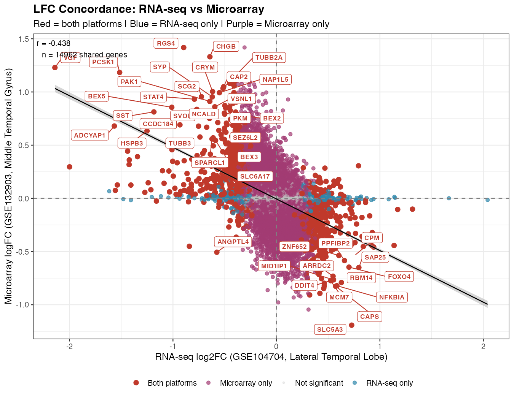
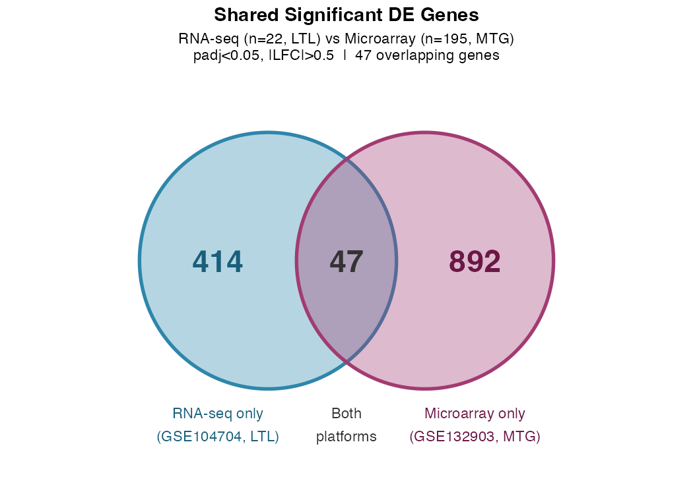

# Cross-Platform Transcriptomic Analysis of Alzheimer's Disease

### RNA-seq (GSE104704) vs. microarray (GSE132903)


An exploratory comparison of Alzheimer's disease (AD) differential expression,
GO/KEGG enrichment, and five classification methods across independent public
brain transcriptomics datasets.

> **Research status:** this repository contains corrected analysis code and
> clearly identified **historical supplied outputs**. Syntax and dependency-free
> regression checks have passed; the corrected biological and ML pipelines have
> **not been run end-to-end**. Historical classification scores are invalid as
> performance estimates because their feature selection used all samples before
> validation. No diagnostic biomarker or clinical performance is established.

## Original project files from Drive

The [supplied project archive](supplied_project/README.md) preserves **35 original
files**, including all original scripts, both platforms' figures and smaller
tables, the RNA-seq pipeline explanation PDF, and the original script ZIP.
Browse the [RNA-seq gallery](supplied_project/RNA_seq/README.md) and
[microarray gallery](supplied_project/micro_array/README.md).

The main report PDF and two large full-DE CSVs are linked to Drive rather than
copied because the authenticated media connection's 1 MB response limit blocked
their download. Large public GEO inputs have a checksum-verified
[download script](supplied_project/download_public_inputs.R).
See the [complete source inventory](supplied_project/FILE_MANIFEST.tsv) for exact
per-file status. Original materials are preserved, not silently replaced by the
corrected code or endorsed as newly validated analysis.

## Datasets

| Dataset | Platform | Analysis samples | Tissue |
|---|---|---|---|
| [GSE104704](https://www.ncbi.nlm.nih.gov/geo/query/acc.cgi?acc=GSE104704) | Illumina RNA-seq | 12 AD + 10 older controls = 22; 8 Young excluded | Lateral temporal lobe |
| [GSE132903](https://www.ncbi.nlm.nih.gov/geo/query/acc.cgi?acc=GSE132903) | Illumina HumanHT-12 v4, GPL10558 | 97 AD + 98 non-demented controls = 195 | Middle temporal gyrus |

**Important:** GSE132903 is not Affymetrix. Its pipeline uses limma on processed
log-expression, not voom. GSE104704's normalized supplementary table is not a raw
count matrix and must not be rounded/truncated for DESeq2.

## What is included

```text
AD-Transcriptomics-CrossPlatform/
├── README.md
├── LICENSE
├── 00_install_packages.R
├── config.R
├── RNA_seq_analysis/
│   ├── deseq2_pipeline.R
│   ├── pathway_enrichment.R
│   └── ml_classification.R
├── Microarray_analysis/
│   ├── limma_pipeline.R
│   ├── pathway_enrichment.R
│   └── ml_classification.R
├── Cross_platform/
│   └── run_comparison.R
├── R/                         # Shared validation, enrichment, comparison and ML
├── data/README.md             # Required inputs and raw-count provenance
├── figures/                   # Three historical supplied images
├── results/                   # Two historical supplied tables
├── docs/                      # Source audit, provenance and verification limits
├── supplied_project/          # Original Drive files, galleries and source links
└── tests/test_core.R
```

Large inputs and generated working outputs are ignored, not represented by fake
CSV tables or placeholder result images.

## Methods in the corrected code

- **RNA-seq DE:** verified integer raw-count input, explicit AD vs Old sample
  mapping, DESeq2 size-factor/dispersion estimation and Wald testing, followed by
  `ashr` log2 fold-change shrinkage. The script stops if raw counts/provenance are
  missing; no raw-count source is invented.
- **Microarray DE:** processed log-expression, unambiguous Illumina probe-symbol
  mapping, label-independent probe averaging, explicit quantile normalization,
  `lmFit` and empirical Bayes moderation. No claim of raw-intensity background
  correction or `neqc()` is made.
- **Thresholds:** BH-adjusted p < 0.05 and |log2FC| > 0.5, configured once in
  `config.R`. This matches the supplied overlap summary's declared cutoff; it
  differs from the original scripts' > 1 cutoff. New DEG counts may change.
- **Enrichment:** clusterProfiler GO Biological Process and KEGG, using mapped
  tested genes as the background universe, with empty-result handling.
- **ML:** LASSO logistic regression, Random Forest, radial SVM, KNN and Gaussian
  Naive Bayes. No global DEG list is used as the feature input. Variance filtering,
  supervised feature ranking, centering and scaling are fitted on training samples
  only. LASSO tuning repeats these operations inside inner folds.
- **Validation:** outer LOOCV for RNA-seq; stratified 80/20 holdout for microarray.
  Other model hyperparameters are fixed in code, not tuned on the held-out data.
  AD is the positive class; ROC direction is fixed. Predictions, selected features,
  splits and session information are exported for audit.
- **Cross-platform comparison:** unique mapped gene symbols; separate correlations
  for all common tested genes and overlapping significant genes. Different cutoffs
  across runs are rejected. Historical files are never overwritten.

Baseline DE models use `~ condition`, not a claim that age, sex, RNA quality,
batch or cellular composition have been controlled. Review available covariates
and design confounding before interpreting disease associations.

## Supplied historical findings—not fresh pipeline results

The supplied summary reports 461 RNA-seq DEGs, 939 microarray DEGs, and 47 shared
DEGs at adjusted p < 0.05 and |log2FC| > 0.5. The complete underlying DE tables
have **not** been independently reproduced in this repository.

What can be checked directly from the committed
[overlap table](results/overlap_DE_genes.csv):

| Check | Result |
|---|---|
| Unique shared genes in the supplied table | 47 |
| Opposite log2FC signs | 46 / 47 |
| Same log2FC sign | 1 / 47: ANGPTL4, downregulated in both |
| Pearson r across these 47 supplied, rounded rows | approximately −0.872 |
| VGF within this table | RNA-seq −2.141; microarray +1.229 |

The supplied scatter reports **r = −0.438 across 14,962 shared genes**. That is a
different gene set, not the correlation of the 47 overlap rows. Its full input
table is not committed here, so that larger-set statistic remains unverified.

Opposite signs do **not** establish regional biological heterogeneity as the
cause. First audit contrast orientation, sample labels, gene mapping, input
normalization, confounders, cohort differences and tissue composition. These are
independent cohorts and tissues, not a controlled comparison of measurement
platforms. ANGPTL4 and VGF are exploratory observations, not validated biomarkers.

### Supplied figures and their interpretation

**Historical LFC scatter:** illustrates the supplied comparison of the broader
gene set; its r and plotted input have not been reproduced by the corrected code.



**Historical overlap diagram:** the supplied 47-gene overlap is consistent with
the overlap CSV's row count. The individual platform DEG totals need a clean rerun.



**Historical ML chart—invalid performance estimates:** retained only for source
traceability, not evidence of predictive accuracy. LOOCV does not repair feature
selection performed using all samples before the folds.

[Open the historical ML comparison—not validated results](figures/ml_comparison_platforms.png)

The [supplied summary CSV](results/cross_platform_summary.csv) also contains
historical ML scores. Those fields are **not valid validation results**. No “best
accuracy”, “best AUC” or model ranking from that file is promoted as a conclusion.

## How to run

Use R >= 4.3 with a compatible Bioconductor release. Run from the repository root.
First read [input requirements](data/README.md) and provide genuine RNA-seq raw
counts plus provenance. The required raw-count matrix is not included.

```r
# From the repository root:
source("00_install_packages.R")
source("RNA_seq_analysis/deseq2_pipeline.R")
source("RNA_seq_analysis/pathway_enrichment.R")
source("RNA_seq_analysis/ml_classification.R")
source("Microarray_analysis/limma_pipeline.R")
source("Microarray_analysis/pathway_enrichment.R")
source("Microarray_analysis/ml_classification.R")
source("Cross_platform/run_comparison.R")
```

Each analysis can also be run with `Rscript <path-to-script>`. Microarray analysis
can run independently while verified RNA-seq counts are being obtained.
GEO and KEGG access require an internet connection. The nested ML run can take
time. Runtime outputs go into each platform's own `results/`, `figures/`, `RDS/`
directories; new comparison tables go to `results/rerun/`.

```sh
# Dependency-free regression checks and syntax checks:
Rscript tests/test_core.R
```

These checks test guards, feature-isolation logic, comparison arithmetic and
syntax. They do not validate model fitting, Bioconductor APIs, enrichment,
scientific conclusions or external reproducibility. See
[verification details](docs/VERIFICATION.md) and [source audit](docs/SOURCE_AUDIT.md).

## Limitations and next scientific steps

- Obtain and verify RNA-seq raw counts before fitting DESeq2.
- Rerun both DE and enrichment pipelines; reconcile totals and contrast signs.
- Rerun corrected ML validation; never reuse historical leaky performance.
- Processed microarray inputs may reflect the submitter's cohort-wide
  normalization. Additional ML preprocessing is training-only, but upstream
  preprocessing cannot be undone from this input.
- Internal validation, especially n = 22 LOOCV, is not external validation.
  Binomial accuracy intervals exported by the ML code are descriptive; LOOCV
  predictions have dependent training sets, so nominal independent-trial coverage
  is not guaranteed. Comparing models and selecting a winner on these same
  estimates also introduces selection optimism.
- Different tissues, cohorts, covariates and measurement technologies are
  confounded. No causal “platform effect” or regional explanation is established.

## Author

**Suraj Rathi** | SynBioAI Lab, Atria University

## License and data attribution

Project code is provided under the [MIT License](LICENSE). GEO data and supplied
study-derived outputs retain their original source terms; the code license does
not relicense third-party data. Cite the original GEO studies and the software
packages used in any publication.
