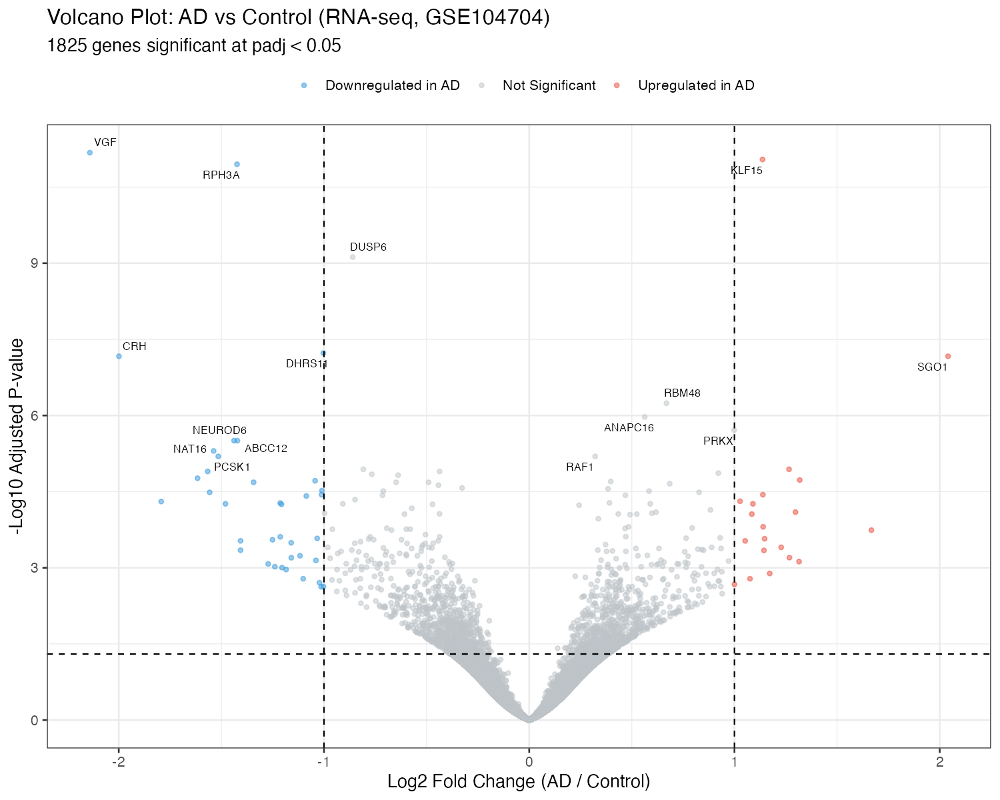
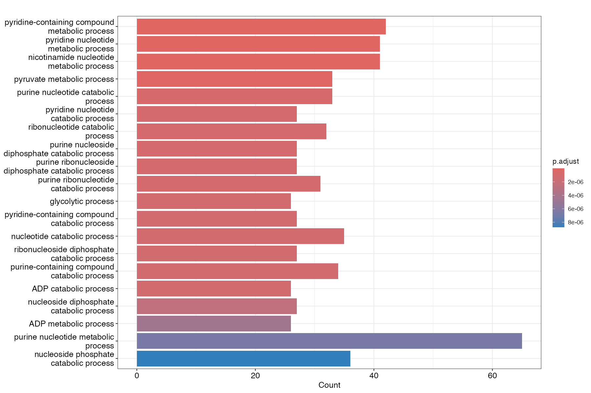
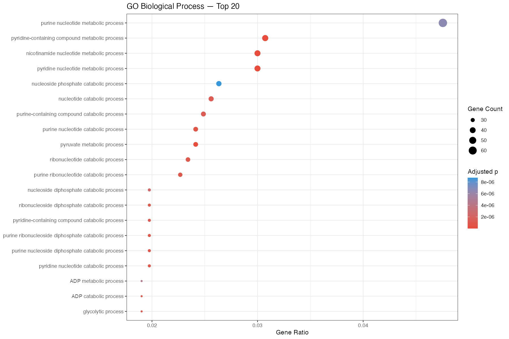
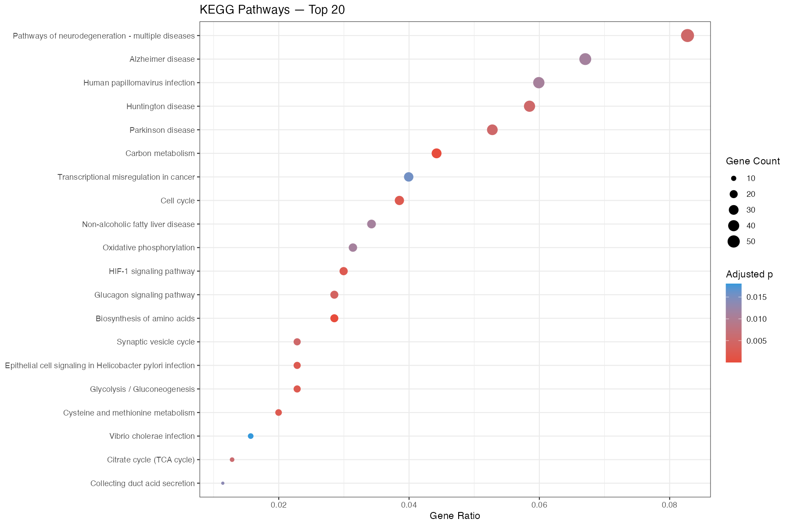
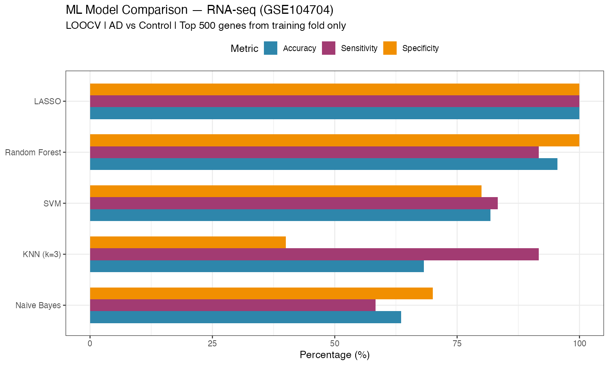
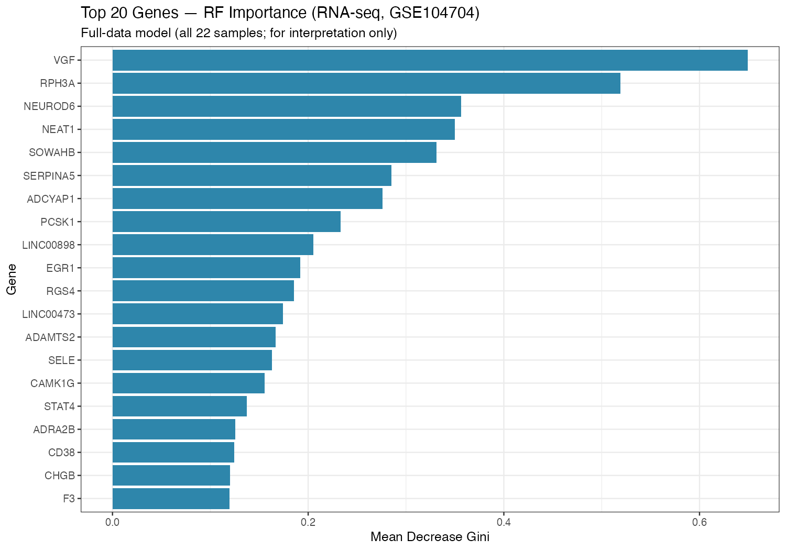

# RNA-seq: supplied historical outputs

These files are preserved from Drive; **they have not been regenerated using
the corrected pipeline**. The report/plot descriptions and archived scripts
disagree about feature selection; supplied ML scores are not independently verified.

## Differential expression

[Top 20 supplied DE genes](top20_DE_genes_rnaseq.csv) ·
[Full supplied DE table—19,130 rows](all_DE_results_rnaseq.csv)

The full CSV is included directly and matches the original Drive file's checksum.
It is preserved unchanged, not regenerated by the corrected analysis.

## Supplied enrichment plots

These are source outputs, not newly confirmed enrichment results.

## Supplied ML—not independently verified

[Original score table](ml_model_results_rnaseq.csv) ·
[Original LOOCV predictions](loocv_predictions_rnaseq.csv)

The feature-importance rankings are exploratory and do not establish biomarkers.

[Original pipeline explanation PDF](RNA-seq%20Pipeline%20%E2%80%94%20Step-by-Step%20Explanation.pdf)
