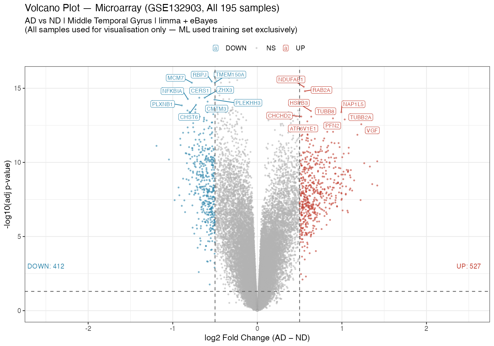
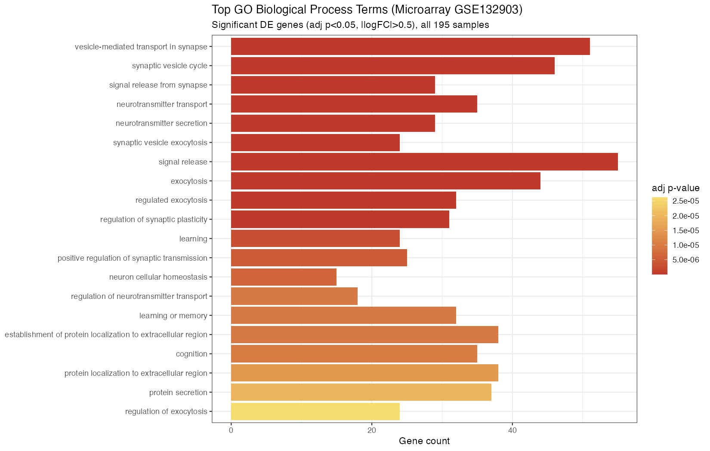
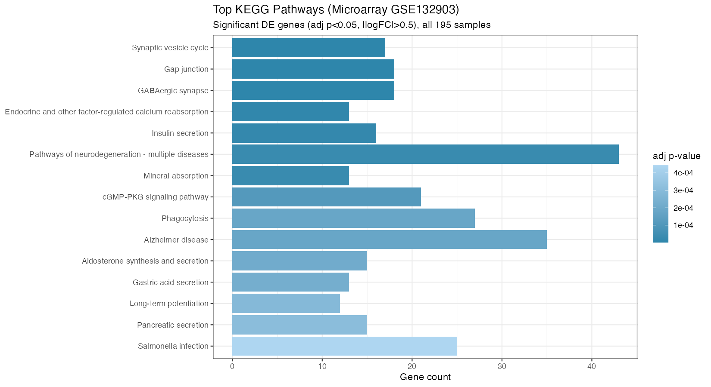
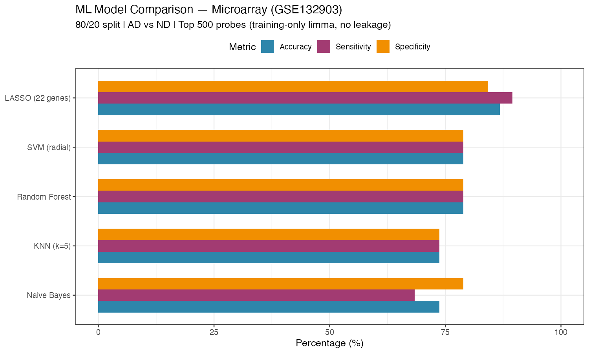
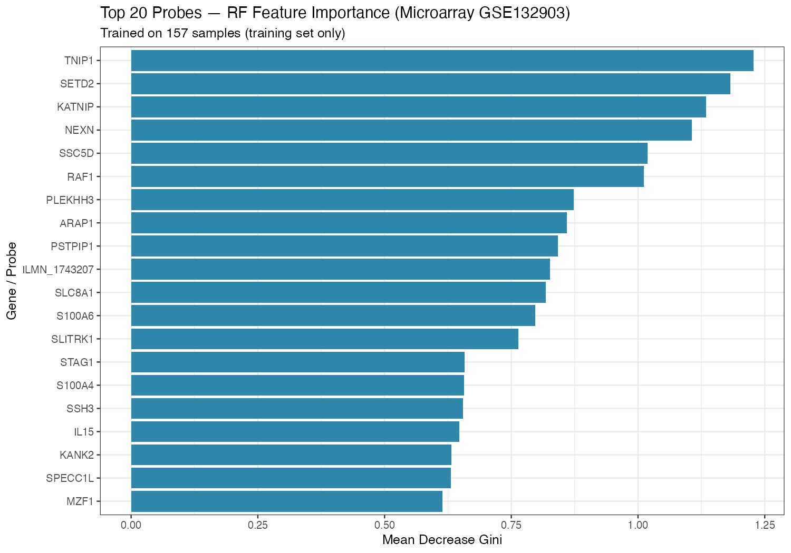

# Microarray: supplied historical outputs

These files are preserved from Drive; **they have not been regenerated using
the corrected pipeline**. The report/plot labels state training-only selection,
but the archived script uses global DEGs; supplied ML scores are not independently verified.

## Differential expression

[Full supplied DE table—42,179 rows](de_results_microarray.csv)

The full CSV is included directly and matches the original Drive file's checksum.
It is preserved unchanged; the number of result rows is not a unique-gene count.

## Supplied enrichment results

These are source outputs, not newly confirmed enrichment results.

[Full supplied GO enrichment table](go_results_microarray.csv)

[Full supplied KEGG enrichment table](kegg_results_microarray.csv)

## Supplied ML—not independently verified

[Original score table](ml_model_results_microarray.csv)

The feature-importance rankings are exploratory and do not establish biomarkers.
